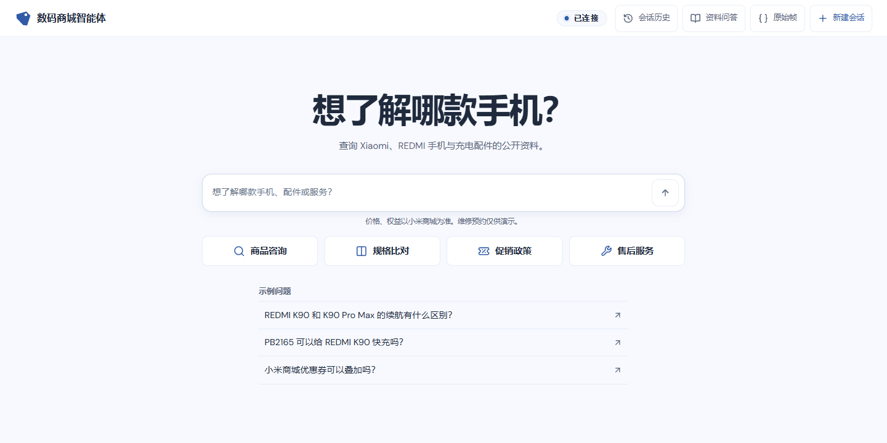
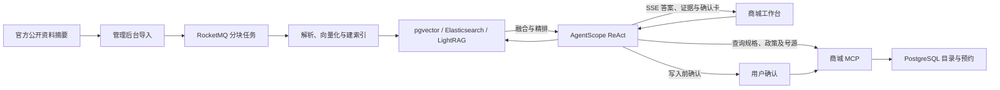

# 数码商城智能体

**查商品、比规格、看优惠、办演示售后。**

数码商城智能体面向 Xiaomi、REDMI 手机与充电配件。用户可以对比两款手机的参数、核对优惠券和价保规则，也可以从充电故障排查进入本地维修预约演示。商品参数和政策依据小米商城中国大陆站公开资料。真实维修可通过小米商城办理。[小米维修预约](https://www.mi.com/service/quick-repair)

### 项目工作

- 整理商品规格、配件兼容关系和售后规则，给每条资料记录来源、地区和采集日期。导入脚本按稳定标识去重，可用同一份目录重复导入。
- 开发商城查询与维修预约 MCP 工具，将排查、查网点、查时段、确认写入和编号回查接入工作台。管理员可在后台导入资料、维护技能和查看链路。
- 接入 pgvector、Elasticsearch 和 LightRAG 三路检索，记录召回、融合、精排和回答实际使用的证据。用固定题集对比单路、双路和三路配置。

[界面预览](#界面预览) · [核心功能](#核心功能) · [系统流程](#系统流程) · [本机启动](#本机启动) · [演示与验收](#演示与验收) · [目录结构](#目录结构)

## 界面预览



截图来自本机工作台，示例问题使用演示数据。右上角可打开会话历史，管理员可从会话面板进入管理后台。

## 核心功能

### 商品查询与规格比对

- 按机型、配件名称或别名查询，展示电池、屏幕、充电等公开参数及来源。两款手机的比对结果并排列出。
- 查询充电兼容性时同时给出证据粒度。系列规格与具体设备实测分开呈现，资料不足时指出缺少的证据。
- 按适用范围解读用券、叠加和价保规则，个人资格和实际结算可到商城核验。

公开目录快照包含 **44 条手机记录、71 款充电配件、4 条政策和 2 类充电故障**。手机记录中有 42 款记录了可核实的规格，另有两条特别版或定制版记录。授权网点可通过单独的采集和导入流程更新。[分页核对记录](resources/store-catalog/listing-scan.json) · [资料来源](resources/store-catalog/sources.json)

### 故障排查与预约确认

助手先澄清机型及故障，检索公开排查资料，再查询官方授权网点或本地演示号源。预约写入前会展示网点、日期和时段，用户确认后才提交。

| MCP 工具 | 用途 |
| --- | --- |
| `store_product`、`store_compare`、`store_compatibility` | 查商品规格、比对机型、核对充电兼容证据 |
| `store_policy`、`store_service_centers` | 查公开政策和已整理的授权网点 |
| `store_demo_slots` | 查询本地演示网点可用时段 |
| `store_create_demo_booking`、`store_my_demo_bookings` | 确认后创建本地演示预约，查询当前账号的预约编号 |

演示预约用 PostgreSQL 唯一约束裁决同一号源的并发写入。重复提交同一预约可回查原编号，个人预约按登录身份隔离。

## 系统流程



## 技术栈

| 层次 | 技术 | 用途 |
| --- | --- | --- |
| 前端 | React、TypeScript、Vite | 工作台、流式消息、预约确认与管理后台 |
| 后端 | Java 17、Spring Boot、AgentScope、MCP | 账号、对话、技能加载、会话记忆和商城工具 |
| 召回与评测 | pgvector、Elasticsearch、LightRAG、Neo4j、RAGAS | 三路召回、加权 RRF、精排和可复现评测 |
| 数据与中间件 | PostgreSQL、Redis、RustFS、RocketMQ | 目录与预约、SSE 任务协调、文档存储与异步入库 |
| 本机部署 | Docker Compose、PowerShell、Python | 初始化中间件、导入目录和启停服务 |

## 本机启动

### 1. 准备环境

| 组件 | 要求 |
| --- | --- |
| 系统 | Windows，并启动 Docker Desktop 的 Linux 引擎 |
| Java 与构建 | JDK 17、Maven |
| 前端与资料导入 | Node.js 22.12 或更新 LTS、Python 3 |
| 模型 | DeepSeek 与阿里云百炼 API Key，启动后端时在本机输入 |

### 2. 下载并构建

```powershell
git clone --depth 1 --single-branch --branch main https://github.com/QYL66/digital-store-agent.git
cd digital-store-agent
mvn.cmd package
Push-Location frontend
npm.cmd ci
npm.cmd test
npm.cmd run build
Pop-Location
```

### 3. 启动、登录与导入

启动脚本使用本机 Docker 镜像。首次运行时可用 `docker pull <镜像>` 按所选检索模式拉取。

| 模式 | 需要的镜像 |
| --- | --- |
| `Vector` | `pgvector/pgvector:pg16`、`redis:8.4-alpine`、`rustfs/rustfs:1.0.0-alpha.72`、`apache/rocketmq:5.2.0` |
| `Keyword` | 在 `Vector` 基础上增加 `docker.elastic.co/elasticsearch/elasticsearch:9.4.8` |
| `Hybrid` | 在 `Keyword` 基础上增加 `neo4j:5.26-community`、`ghcr.io/hkuds/lightrag:v1.5.7` |

1. 双击 [启动数码商城智能体](local/Start-StoreAgent.cmd)，或从 PowerShell 执行 `.\local\Start-StoreAgent.ps1 -RetrievalMode Vector`。首次启动时设置至少 12 个字符的管理员密码，并按提示输入模型 Key。
2. 打开 [本机商城工作台](http://127.0.0.1:25173/)，使用 `admin` 和刚设置的密码登录。
3. 运行 [导入演示资料](local/Import-StoreAgentDemo.cmd)。脚本会导入目录和知识库摘要，并检查文档分块状态。
4. 用完后运行 [停止数码商城智能体](local/Stop-StoreAgent.cmd)。本机数据位于 `digital-store-agent-local` 的 Compose 数据卷中。

### 常见问题

| 现象 | 检查位置 |
| --- | --- |
| 脚本提示缺少构建产物 | 在仓库根目录完成 Maven 打包，在 `frontend/` 完成 `npm.cmd ci`。 |
| 提示 Docker 引擎不可用 | 启动 Docker Desktop 并等待 Linux 引擎就绪。 |
| 脚本提示端口占用 | 前端使用 `25173`，后端使用 `29090`，MCP 使用 `29099`。中间件端口见 [Compose 配置](local/compose.yaml)。 |
| 模型请求或文档分块失败 | 查看 `local/logs/`，用 [模型连通性脚本](local/Test-StoreAgentProviders.ps1)验证 DeepSeek 和百炼凭据。 |

## 演示与验收

| 场景 | 操作 | 核对结果 |
| --- | --- | --- |
| 规格与快充 | 比较 REDMI K90 和 K90 Pro Max 的电池与充电，再追问 PB2165 给当前机型充电的功率。 | 两款机型各自带来源，配件结论说明证据粒度。 |
| 排查与预约 | 输入“换了线还是充不上电”，补充机型、哈尔滨和期望日期，选择演示时段并确认。 | 生成演示预约编号，从“查询我的演示维修预约”可查回同一编号。 |

[11 项技术验收](docs/acceptance.md) · [评测方法与题集](docs/evaluation/README.md) · [后续验收与发布清单](docs/后续验收与发布清单.md)

### 检索评测

三套检索配置使用同一批 **52 份摘要、60 道题**，共进行 180 次真实问答。下表对应评测时的资料规模。[评测目录快照](docs/evaluation/catalog-snapshot-2026-11-20.json) · [24 项指标与逐题结果](docs/evaluation/store-results-2026-11-20.json)

| 检索配置 | Faithfulness | 回答相关性 | 总耗时 P95 |
| --- | ---: | ---: | ---: |
| 向量 | 91.74% | 72.26% | 9.09 秒 |
| 向量＋关键词 | 90.58% | 70.69% | 10.65 秒 |
| 向量＋关键词＋图谱 | 94.45% | 72.91% | 14.85 秒 |

## 目录结构

| 路径 | 内容 |
| --- | --- |
| [`frontend/`](frontend) | 登录、商城工作台、资料问答和管理后台 |
| [`bootstrap/`](bootstrap) | Spring Boot 应用入口与默认配置 |
| [`agent/`](agent)、[`rag/`](rag) | 对话、技能、记忆、人工确认、知识库和召回 |
| [`mcp-server/`](mcp-server) | 商品、政策、网点、号源及演示预约工具 |
| [`system/`](system)、[`framework/`](framework)、[`infra-ai/`](infra-ai) | 账号权限、通用基础能力和模型服务适配 |
| [`local/`](local)、[`scripts/`](scripts) | Windows 启停、目录导入和验证脚本 |
| [`resources/`](resources)、[`docs/`](docs) | 初始化 SQL、公开目录、界面截图和评测记录 |

## 开源许可

商城业务由 [QYL66](https://github.com/QYL66) 维护。通用 Agent、RAG、会话及工具确认能力沿用 Apache-2.0 底座。[Apache-2.0](LICENSE) · [开源来源声明](OPEN_SOURCE.md)
