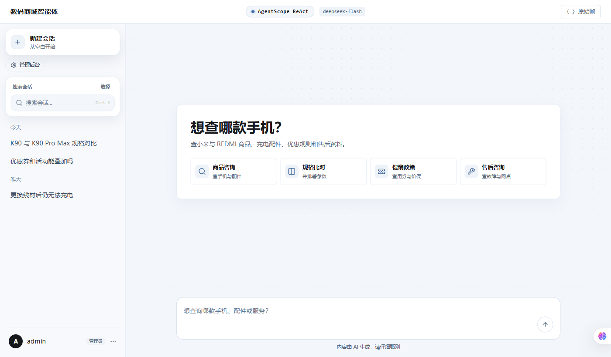
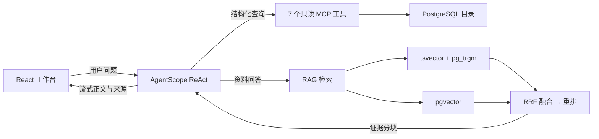

# 数码商城智能体

面向小米商城中国大陆站的导购与售后问答。能查手机规格、比较机型、核对快充兼容性，并附上可核查的官方来源。

```text
Query ──→ AgentScope ReAct
          ├─→ MCP → 型号、规格、兼容证据
          └─→ RAG → 关键词 + 向量 → RRF → 重排
UI    ←── SSE ── AgentScope ReAct（流式正文与来源）
```

`Java 17` `Spring Boot 4.1` `AgentScope` `MCP` `PostgreSQL / pgvector` `React` · [Apache-2.0](LICENSE)

[本机启动](#本机启动) · [系统流程](#系统流程) · [评测结果](#评测结果) · [界面预览](#界面预览) · [目录结构](#目录结构)

## 评测结果

**离线检索 · 30 题 / 121 个固定分块。** 两组重排都取 20 个候选，用同一模型重排后评估 Top 5。

| 检索配置 | Hit@5 | Recall@5 | MRR@5 |
| --- | ---: | ---: | ---: |
| pgvector | 56.7% | 48.3% | 0.448 |
| pgvector + 重排 | 80.0% | 70.0% | 0.767 |
| PostgreSQL 混合检索 + 重排 | **93.3%** | **86.7%** | **0.883** |

**真实问答 · 50 题 / 60 回合。** 60 回合均完整返回，关键事实通过 **44/50**，完整可点击引用 36/50。调用 0–1 次和 ≥2 次工具的回合，首段可见正文 P50 分别为 **1.70 s** 和 **5.57 s**。

22 例快充风险题中，0 例把配件标称功率当作具体配对实测功率，1 例将系列功率区间误套到具体配对。

[完整评测报告](docs/eval-report.md) · [题库与真值](docs/benchmark/eval_dataset_50.json) · [检索逐题数据](docs/benchmark/rag_ablation_results.csv) · [问答逐回合数据](docs/benchmark/e2e_eval_results.csv)

## 界面预览



截图使用本机运行的前端和示例会话，展示商城快捷入口、历史会话与管理后台入口。

## 核心功能

### 带出处的商城查询

随仓库提供的目录于 **2026 年 11 月 20 日**核对，包含 **44 条手机记录、71 条充电配件记录、4 条政策和 2 条故障资料**。目录按快照查询，逐条记录地区、来源和核对日期。实时上新、库存、价格及个人优惠资格以小米商城为准。[目录数据](resources/store-catalog/records.json) · [公开资料来源](resources/store-catalog/sources.json) · [目录分页记录](resources/store-catalog/listing-scan.json) · [小米商城](https://www.mi.com/shop)

| 场景 | 实现方式 |
| --- | --- |
| 商品咨询 | 按型号、别名或系列查目录。名称可能匹配多款机型时，返回候选项供确认。 |
| 规格比对 | 按屏幕、芯片、电池和充电等字段并排展示两款手机。缺少的参数标为「资料未记录」。 |
| 充电配件 | 分别列出手机协议、配件的标称输出和兼容证据。只有系列级证据时，提示具体机型的实际功率待确认。 |
| 促销与售后 | 查阅优惠券、价保、售后政策和充电故障资料。按城市查询已收录网点，缺少记录时给出官方查询入口。 |

### 知识库与管理后台

商城摘要可导入知识库。RustFS 存放文档，RocketMQ 投递分块任务，后端解析并计算向量后写入 PostgreSQL/pgvector。资料问答流式返回结果，可展开引用核对。管理员可以维护知识库、文档、工具与示例问题，并查看检索链路。

## 系统流程



- **商城工具**。规格比对按机型返回出处。快充查询把手机支持的协议、配件标称输出和具体配对证据分开，缺少配对证据时提示实际协商功率待核实。
- **混合检索**。提取型号与功率词供 `tsvector` 匹配，用 `word_similarity` 处理短问题与长分块。关键词和向量结果经 RRF 融合后重排。本机启动默认使用 `PgHybrid`，可切回纯向量或选用 Elasticsearch。
- **会话记忆**。事务外提取用户事实，提交时按预期消息游标校验，事实变更和游标推进在同一事务中完成。上下文压缩时保留近期消息和成对工具调用记录。

[商城工具源码](mcp-server/src/main/java/io/github/qyl66/storeagent/mcp/store/StoreTools.java) · [PostgreSQL 关键词检索](rag/src/main/java/io/github/qyl66/storeagent/rag/core/keyword/PgKeywordRetrieverService.java) · [检索融合](rag/src/main/java/io/github/qyl66/storeagent/rag/core/retrieval/postprocessor/FusionPostProcessor.java) · [记忆事务](agent/src/main/java/io/github/qyl66/storeagent/agent/memory/AgentMemoryRepository.java)

<details>
<summary>文档导入与服务组件</summary>

管理后台将文档存入 RustFS，通过 RocketMQ 投递分块任务，解析和向量化后写入 PostgreSQL/pgvector。应用使用 MyBatis-Plus、Redis、DeepSeek 与阿里云百炼，本机中间件由 Docker Compose 管理。

</details>

## 本机启动

### 1. 准备环境

需要 Windows、JDK 17、Maven、Node.js 22.12 或更新 LTS 版本、Python 3.10 或更新版本，以及已启动 Linux 引擎的 Docker Desktop。准备 DeepSeek 与阿里云百炼 API Key，启动时在本机输入。

本机启动器默认以 PostgreSQL 原生关键词检索与 pgvector 向量检索做 RRF 融合。需要回退时可用 `local/Start-StoreAgent.ps1 -RetrievalMode Vector`，ES 通过 `-RetrievalMode Keyword` 显式启用。首次运行前，若本机缺少镜像，可用 `docker pull <镜像>` 拉取 `pgvector/pgvector:pg16`、`redis:8.4-alpine`、`rustfs/rustfs:1.0.0-alpha.72` 和 `apache/rocketmq:5.2.0`。[Compose 配置](local/compose.yaml)

### 2. 下载并构建

```powershell
git clone --depth 1 --branch main https://github.com/QYL66/digital-store-agent.git
cd digital-store-agent
mvn.cmd -DskipTests package
Push-Location frontend
npm.cmd ci
npm.cmd run typecheck
npm.cmd run build
Pop-Location
```

### 3. 启动和登录

1. 双击 [启动数码商城智能体](local/Start-StoreAgent.cmd)。首次启动会建立本机数据库、导入商城目录，并提示设置至少 12 个字符的管理员密码。按提示输入模型 Key。
2. 打开 [本机工作台](http://127.0.0.1:25173/chat)，使用 `admin` 和刚设置的密码登录。右上角可在「商城导购」和「知识问答」之间切换，知识问答输入框下方有「深度思考」开关。管理后台位于左侧「新建会话」下方。
3. 要演示带引用的资料问答，双击 [导入商城知识库](local/Import-StoreAgentDemo.cmd)。用管理员密码认证后，脚本导入商城资料摘要并等待分块完成。
4. 用完后双击 [停止服务](local/Stop-StoreAgent.cmd)。数据库和文档保存在 `digital-store-agent-catalog-local` 的 Compose 数据卷中。

前端、应用后端和 MCP 的默认端口分别是 `25173`、`29090` 和 `29099`，应用 API 前缀为 `/api/store-agent`。遇到启动或分块失败，可查看 `local/logs/` 中对应服务日志，核对 Docker 状态、端口与模型权限。

## 演示与验收

| 场景 | 试问 | 核对项 |
| --- | --- | --- |
| 上新咨询 | 最新的手机 | 说明目录快照无法确认发布顺序，给出小米商城入口。 |
| 商品规格 | REDMI K90 的电池容量和有线充电功率是多少？ | 返回典型电池容量和充电器标称功率，可打开官方规格页核对。 |
| 多轮比对 | 比较 K90 和 K90 Pro Max。再问「PB2165 给 K90 充电能跑多少瓦？」 | 并排列出规格并分别给出来源。追问时返回系列级证据和具体功率的适用限制。 |
| 优惠政策 | 小米商城优惠券能叠加吗？ | 回答适用规则并给出来源，实际结算优惠以官方页面为准。 |
| 售后排查 | 换了充电线还是充不上电，可以怎么排查？哈尔滨的授权网点在哪里查？ | 给出排查步骤、资料来源和官方网点查询入口。 |

### 本机复验结果

- **构建与测试**。后端 Maven 打包成功，856 项测试通过，24 项按条件跳过。前端 TypeScript 类型检查、ESLint 和生产构建通过。
- **目录与工具**。在临时 PostgreSQL 首次导入 121 条记录，原样重导入新增和更新均为 0。通过实际 MCP HTTP 请求验证鉴权、只读标记、规格对比、配件证据、促销和售后查询。
- **真实模型对话**。通过前端代理调用实际 SSE 接口，验证「最新的手机」、K90 与 K90 Pro Max 对比、同会话追问 PB2165、优惠券和售后查询。五轮都流式返回并正常结束。
- **知识库引用**。用百炼向量模型导入 6 份样例资料，共生成 6 个分块。针对「换线后仍充不上电」发起资料问答，流式答案引用《手机无法充电与充电慢》，可通过引用预览核对排查说明和官方来源。

启动后运行 `.\local\Verify-StoreAgentMcp.ps1` 可复验 MCP。运行 `.\local\Import-StoreCatalog.ps1` 可重复导入结构化数据并查看 `local/logs/catalog-coverage.json`。

## 目录结构

| 路径 | 内容 |
| --- | --- |
| [`frontend/`](frontend) | 商城问答、会话历史、账号与管理后台 |
| [`bootstrap/`](bootstrap) | `StoreAgentApplication` 入口、模型和应用配置 |
| [`agent/`](agent)、[`rag/`](rag) | Agent 对话、会话记忆、知识库、检索和流式回答 |
| [`mcp-server/`](mcp-server) | 商城工具、目录查询与 MCP 服务 |
| [`system/`](system)、[`framework/`](framework)、[`infra-ai/`](infra-ai) | 账号与管理、通用组件和模型适配 |
| [`resources/store-catalog/`](resources/store-catalog) | 目录快照、公开来源与分页记录 |
| [`local/`](local)、[`scripts/`](scripts) | 启停、导入与验证脚本 |
