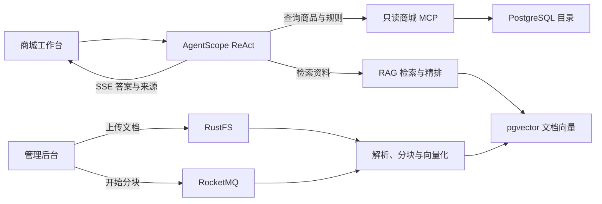

# 数码商城智能体

**查手机规格、比同系列机型、核对优惠与售后规则。**

数码商城智能体是一个面向小米商城中国大陆站的 AI 查询助手。用户可以查 Xiaomi、REDMI 手机和充电配件，对比两款机型，追问配件的快充兼容性，也可以查询优惠券、价保和充电故障的公开资料。回答提供官方来源，方便核对。

### 我的项目工作

- 在 Ragent 的 Agent、RAG 和管理后台上接入小米商城场景，配置商城提示词、工具与示例问题，完成工作台和 Windows 本机部署适配。
- 整理官方目录和支持资料，统一机型别名、规格字段、配件兼容证据和来源。导入脚本按稳定标识更新 PostgreSQL，并生成涵盖各系列及字段缺失情况的报告。
- 编写 7 个只读商城 MCP 工具。对比时逐款返回出处，快充查询区分具体机型和系列证据。缺少实时价格、库存或个人优惠资格证据时，引导用户在小米官网核对。

[界面预览](#界面预览) · [核心功能](#核心功能) · [系统流程](#系统流程) · [本机启动](#本机启动) · [演示与验收](#演示与验收) · [目录结构](#目录结构)

## 界面预览


截图使用本机运行的前端和示例会话，展示商城快捷入口、历史会话与管理后台入口。

## 核心功能

### 带出处的商城查询

随仓库提供的目录于 **2026 年 11 月 20 日**核对，包含 **44 条手机记录、71 条充电配件记录、4 条政策和 2 条故障资料**。目录按快照查询，逐条记录地区、来源和核对日期。实时上新、库存、价格及个人优惠资格以小米商城为准。[目录数据](resources/store-catalog/records.json) · [公开资料来源](resources/store-catalog/sources.json) · [目录分页记录](resources/store-catalog/listing-scan.json) · [小米商城](https://www.mi.com/shop)

| 场景 | 实现方式 |
| --- | --- |
| 商品咨询 | 按型号、别名或系列查目录。名称可能匹配多款机型时，返回候选项供确认。 |
| 规格比对 | 按屏幕、芯片、电池和充电等字段并排展示两款手机。缺少的参数标为「资料未记录」。 |
| 充电配件 | 分别列出手机协议、配件的标称输出和兼容证据。只有系列级证据时，提示具体机型的实际功率待确认。 |
| 促销与售后 | 查阅优惠券、价保、售后政策和充电故障资料。按城市查询已收录网点，缺少记录时给出官方查询入口。 |

### 知识库与管理后台

商城摘要可导入知识库。RustFS 存放文档，RocketMQ 投递分块任务，后端解析并计算向量后写入 PostgreSQL/pgvector。资料问答流式返回结果，可展开引用核对。管理员可以维护知识库、文档、工具与示例问题，并查看检索链路。

## 系统流程



## 技术栈

| 层次 | 技术 | 用途 |
| --- | --- | --- |
| 前端 | React、TypeScript、Vite | 商城工作台、流式对话、会话历史和后台管理 |
| 后端 | Java 17、Spring Boot、MyBatis-Plus | 登录鉴权、资料管理、流式接口与服务编排 |
| Agent 与模型 | AgentScope、MCP、DeepSeek、阿里云百炼 | 对话推理、商城工具调用、向量化与精排 |
| 数据与中间件 | PostgreSQL、pgvector、Redis、RocketMQ、RustFS | 目录、向量索引、登录状态、异步分块和文档存储 |
| 本机部署 | Docker Compose、PowerShell、Python | 管理中间件、导入快照和复验查询 |

## 本机启动

### 1. 准备环境

需要 Windows、JDK 17、Maven、Node.js 22.12 或更新 LTS 版本、Python 3.10 或更新版本，以及已启动 Linux 引擎的 Docker Desktop。准备 DeepSeek 与阿里云百炼 API Key，启动时在本机输入。

默认以 pgvector 启动。首次运行前，若本机缺少镜像，可用 `docker pull <镜像>` 拉取 `pgvector/pgvector:pg16`、`redis:8.4-alpine`、`rustfs/rustfs:1.0.0-alpha.72` 和 `apache/rocketmq:5.2.0`。[Compose 配置](local/compose.yaml)

### 2. 下载并构建

```powershell
git clone --depth 1 --branch main https://github.com/QYL66/digital-store-agent.git
cd digital-store-agent
mvn.cmd -DskipTests package
Push-Location frontend
npm.cmd ci
npm.cmd run typecheck
npm.cmd run build
Pop-Location
```

### 3. 启动和登录

1. 双击 [启动数码商城智能体](local/Start-StoreAgent.cmd)。首次启动会建立本机数据库、导入商城目录，并提示设置至少 12 个字符的管理员密码。按提示输入模型 Key。
2. 打开 [本机工作台](http://127.0.0.1:25173/chat)，使用 `admin` 和刚设置的密码登录。管理后台位于左侧「新建会话」下方。
3. 要演示带引用的资料问答，双击 [导入商城知识库](local/Import-StoreAgentDemo.cmd)。用管理员密码认证后，脚本导入商城资料摘要并等待分块完成。
4. 用完后双击 [停止服务](local/Stop-StoreAgent.cmd)。数据库和文档保存在 `digital-store-agent-catalog-local` 的 Compose 数据卷中。

前端、应用后端和 MCP 的默认端口分别是 `25173`、`29090` 和 `29099`，应用 API 前缀为 `/api/store-agent`。遇到启动或分块失败，可查看 `local/logs/` 中对应服务日志，核对 Docker 状态、端口与模型权限。

## 演示与验收

| 场景 | 试问 | 核对项 |
| --- | --- | --- |
| 上新咨询 | 最新的手机 | 说明目录快照无法确认发布顺序，给出小米商城入口。 |
| 商品规格 | REDMI K90 的电池容量和有线充电功率是多少？ | 返回典型电池容量和充电器标称功率，可打开官方规格页核对。 |
| 多轮比对 | 比较 K90 和 K90 Pro Max。再问「PB2165 给 K90 充电能跑多少瓦？」 | 并排列出规格并分别给出来源。追问时返回系列级证据和具体功率的适用限制。 |
| 优惠政策 | 小米商城优惠券能叠加吗？ | 回答适用规则并给出来源，实际结算优惠以官方页面为准。 |
| 售后排查 | 换了充电线还是充不上电，可以怎么排查？哈尔滨的授权网点在哪里查？ | 给出排查步骤、资料来源和官方网点查询入口。 |

### 本机复验结果

- **构建与测试**。后端 Maven 打包成功，856 项测试通过，24 项按条件跳过。前端 TypeScript 类型检查、ESLint 和生产构建通过。
- **目录与工具**。在临时 PostgreSQL 首次导入 121 条记录，原样重导入新增和更新均为 0。通过实际 MCP HTTP 请求验证鉴权、只读标记、规格对比、配件证据、促销和售后查询。
- **真实模型对话**。通过前端代理调用实际 SSE 接口，验证「最新的手机」、K90 与 K90 Pro Max 对比、同会话追问 PB2165、优惠券和售后查询。五轮都流式返回并正常结束。
- **知识库引用**。用百炼向量模型导入 6 份样例资料，共生成 6 个分块。针对「换线后仍充不上电」发起资料问答，流式答案引用《手机无法充电与充电慢》，可通过引用预览核对排查说明和官方来源。

启动后运行 `.\local\Verify-StoreAgentMcp.ps1` 可复验 MCP。运行 `.\local\Import-StoreCatalog.ps1` 可重复导入结构化数据并查看 `local/logs/catalog-coverage.json`。

## 目录结构

| 路径 | 内容 |
| --- | --- |
| [`frontend/`](frontend) | 商城问答、会话历史、账号与管理后台 |
| [`bootstrap/`](bootstrap) | `StoreAgentApplication` 入口、模型和应用配置 |
| [`agent/`](agent)、[`rag/`](rag) | Agent 对话、会话记忆、知识库、检索和流式回答 |
| [`mcp-server/`](mcp-server) | 商城工具、目录查询与 MCP 服务 |
| [`system/`](system)、[`framework/`](framework)、[`infra-ai/`](infra-ai) | 账号与管理、通用组件和模型适配 |
| [`resources/store-catalog/`](resources/store-catalog) | 目录快照、公开来源与分页记录 |
| [`local/`](local)、[`scripts/`](scripts) | 启停、导入与验证脚本 |
